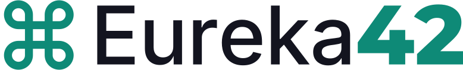
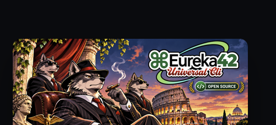
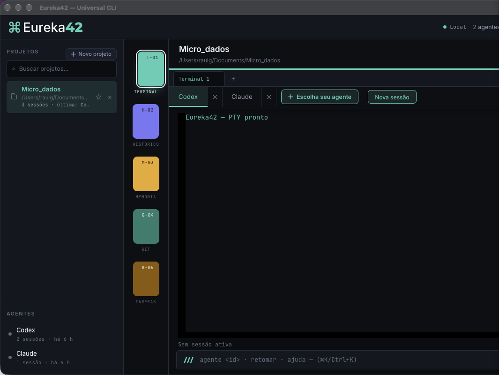
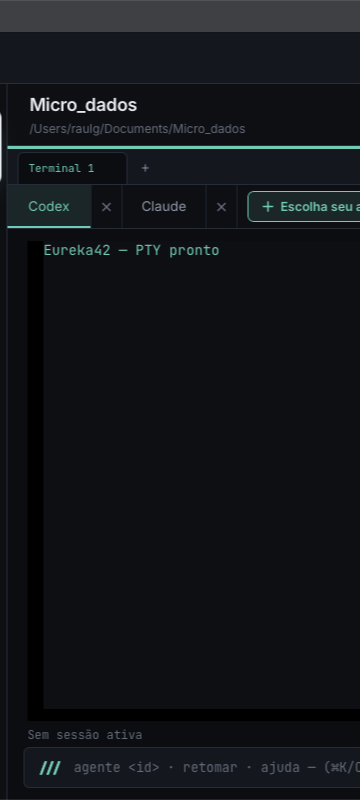
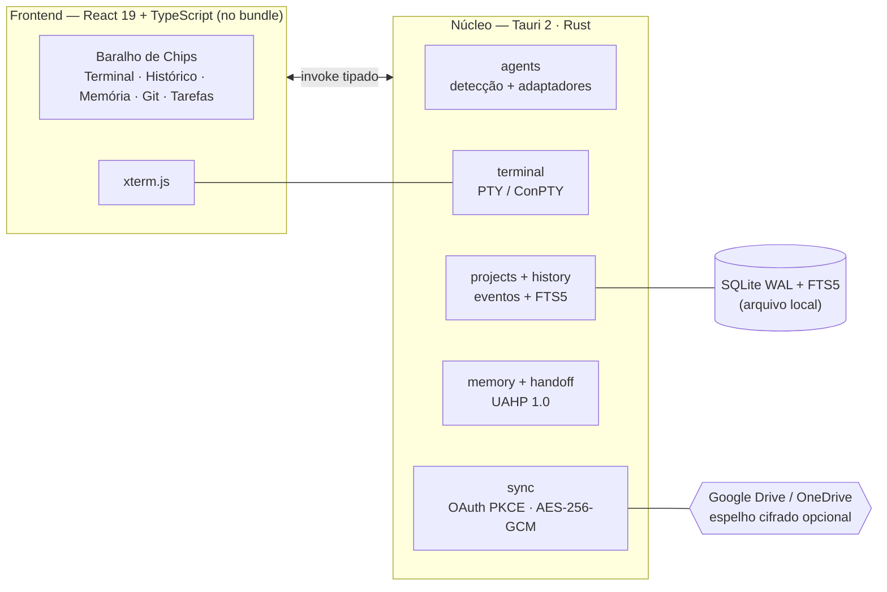
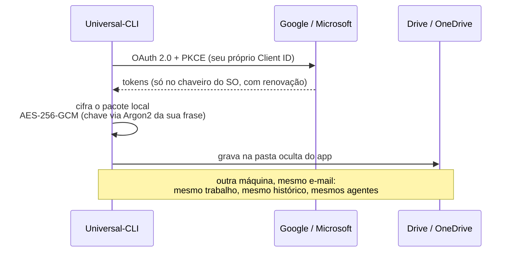

<p align="center">
  
</p>

<p align="center">
  <strong>Um orquestrador desktop local-first para qualquer CLI de IA.</strong><br>
  Codex · Claude Code · OpenCode · Kimi · Gemini · Aider · Cursor · Amp · Goose · Qwen · <em>a sua também</em>
</p>

<p align="center">
  
  
  
  
  
  
  
</p>

<p align="center">
  
</p>

<p align="center">
  
</p>

---

## O que é o Universal-CLI?

O **Universal-CLI** (nome de produto: *Eureka42 — Universal CLI*) é um aplicativo
desktop de código aberto que organiza **qualquer interface de linha de comando de
IA** em projetos reais: ele detecta as CLIs instaladas na sua máquina, abre cada uma
em um **terminal PTY verdadeiro** (a TUI completa, sem simulação), guarda histórico,
memória e tarefas por projeto — e sincroniza tudo, cifrado, com **a sua própria
nuvem** (Google Drive ou OneDrive).

Você não cria conta em mais nada: **a conta que você já tem é a identidade**. Mesmo
e-mail em outra máquina = mesmo trabalho.

## O manifesto Eureka42

> **Eureka** é o instante da descoberta. **42** é a resposta. **⌘** é o atalho.

O nome resume a filosofia do projeto:

1. **Local-first radical.** O núcleo, o banco, a memória e os seus dados ficam no
   seu computador. Não existe servidor Eureka42, conta própria, telemetria ou
   sincronização obrigatória. A nuvem é um espelho opcional — e é a *sua*.
2. **Qualquer agente, sem imitação.** O app não reproduz CLIs: ele executa os
   binários reais que você instalou, preservando TUI, autenticação, MCP, skills,
   plugins e permissões de cada ferramenta. Se amanhã existir uma CLI nova, você a
   registra e ela passa a funcionar — sem esperar atualização nossa.
3. **Você é o dono do contexto.** Memória universal por projeto, tarefas com
   proveniência e pacotes de handoff **verificáveis** (UAHP 1.0): a troca de agente
   transmite um pacote explícito e auditável, nunca o estado oculto de um modelo.
4. **Capacidade só com evidência.** Cada adaptador declara o que foi validado no
   binário real instalado — retomada de sessão, flags, versões. Nada é presumido
   pela documentação; o que não foi testado é dito.
5. **Sem clichê de IA.** Nem cérebros, nem robôs, nem degradê roxo. Interface
   escura sobre a grade 42, tipografia Inter/Montserrat/JetBrains Mono e o
   *Baralho de Chips* — fichas de cor por função, como um baralho na mesa.
6. **Código aberto.** O projeto é público e construído às claras, com o histórico
   de decisões em `docs/decisions/`.

## Como é a interface

<p align="center">
  
</p>

O coração da UI é o **Baralho de Chips** — cada função é uma ficha de cor na mesa:

<p align="center">
  
</p>

| Ficha | Função |
|---|---|
| 🟩 **T-01 Terminal** | Até 6 terminais PTY independentes por projeto, com xterm.js |
| 🟪 **H-02 Histórico** | Sessões e eventos persistentes, busca FTS5, filtros, exportação |
| 🟨 **M-03 Memória** | Memória estruturada, tarefas e o contexto universal do projeto |
| 🟩 **G-04 Git** | Estado do repositório somente leitura — nunca commit/stash automáticos |
| 🟫 **K-05 Tarefas** | Tarefas por projeto com proveniência de quem criou |

## Funcionalidades

- **Agentes dinâmicos** — catálogo ampliado (Codex, Claude Code, OpenCode, Kimi,
  Gemini, Aider, Cursor Agent, Amp, Goose, Qwen) **+ agentes personalizados**:
  qualquer executável do seu PATH vira um agente. O botão **"Escolha seu agente"**
  conecta na hora; cada aba tem × para encerrar a sessão sem perder histórico.
- **Terminal real** — PTY nativo (`portable-pty`: ConPTY no Windows) com
  `xterm-256color`, resize, Unicode e sinais. A TUI de cada CLI aparece íntegra.
- **Contexto universal entre conversas** — o app mantém `.eureka42/contexto.md` no
  projeto (memória + tarefas em aberto + conversas recentes) e o injeta nas novas
  sessões do Claude Code via `--append-system-prompt`; nos demais agentes o
  contexto fica no arquivo, pronto para apontar ou colar. Desligável na privacidade.
- **Histórico pesquisável** — SQLite com FTS5: busca por projeto, agente, período,
  estado e texto; detalhe de eventos e exportação Markdown/JSON/TXT.
- **Handoff verificável (UAHP 1.0)** — pacote explícito com manifesto, memória,
  tarefas e contexto para trocar de agente sem perder o fio da meada.
- **Retomada nativa quando suportada** — `codex resume --last`, `--continue` em
  Claude/OpenCode/Kimi — sempre validada no binário instalado, nunca presumida.
- **Sincronização pela sua nuvem** — Google Drive ou OneDrive, OAuth PKCE com o seu
  próprio Client ID, tokens só no chaveiro do SO, tudo cifrado no cliente
  (AES-256-GCM + Argon2) antes de sair da máquina. Sincroniza preferências,
  agentes personalizados, memória, tarefas, contexto e — com opt-in por projeto —
  arquivos (exceto `.git`, dependências e segredos; nunca apaga; conflitos perguntam).
- **Funciona offline** — sem nuvem configurada, tudo continua funcionando localmente.
- **Atualização automática** — `tauri-plugin-updater` com pacotes assinados
  publicados em CI como rascunho (release só sai por publicação manual).

## Linguagens e tecnologias

O projeto usa deliberadamente **três linguagens**, cada uma onde faz mais sentido:

| Linguagem | Onde atua | Por quê |
|---|---|---|
| **Rust** (~60% do núcleo) | Todo o backend Tauri: PTY, processos, SQLite, FTS5, criptografia, OAuth, sync, chaveiro | Segurança de memória sem GC, binário nativo único, acesso direto a APIs do SO |
| **TypeScript** (~35%) | Toda a UI: React 19, componentes, serviços de invoke tipados | Tipagem estática no frontend, ecossistema maduro de componentes |
| **SQL** | Esquema e consultas do SQLite (WAL + FTS5) | Busca full-text indexada e persistência transacional declarativas |

**Ferramentas:** Tauri 2 · React 19 + Vite 8 · xterm.js · `portable-pty` ·
SQLite FTS5 · GitHub Actions (CI macOS/Windows/Linux) · assinatura minisign do updater.

## Arquitetura



Comunicação com provedores de IA **somente** pelas CLIs que você instalou e
autenticou — o app nunca toca nos tokens delas.

## Fluxo de sincronização



## Agentes suportados

| Agente | Detecção automática | Retomada nativa validada |
|---|---|---|
| Codex CLI | ✅ | `codex resume --last` |
| Claude Code | ✅ | `--continue` |
| OpenCode | ✅ | `--continue` |
| Kimi Code CLI | ✅ | `--continue` |
| Gemini · Aider · Cursor · Amp · Goose · Qwen | ✅ se instalados | conforme a CLI expuser |
| **Qualquer executável** | ✅ agente personalizado | — |

A detecção procura nos diretórios padrão de cada SO (incluindo `PATHEXT` e
shims `.cmd` no Windows). Detalhes em `docs/03-AGENTES-E-TERMINAL.md`.

## Instalação

Baixe o pacote da sua plataforma na [página de Releases](../../releases)
(o CI builda **macOS** `.dmg`, **Windows** `.exe`/`.msi` e **Linux** `.deb`/`.AppImage`).

**macOS** (Apple Silicon): a build atual usa **assinatura ad-hoc** — no primeiro
clique, use botão direito → Abrir (ou `xattr -dr com.apple.quarantine Eureka42.app`).
Notarização Apple Developer ainda não configurada.

**Windows**: o instalador NSIS embute o bootstrapper do WebView2 e oferece
PT-BR/EN; modo de instalação "só para mim" ou "todos os usuários".

**Linux** (Ubuntu/Debian): `sudo dpkg -i Eureka42_0.1.0_amd64.deb` (resolve as
deps `libwebkit2gtk-4.1`/`libgtk-3` pelo apt) — ou rode o `Eureka42_0.1.0_amd64.AppImage`
direto: `chmod +x` e pronto.

## Desenvolvimento

```bash
npm install                # dependências do frontend
npm run build              # typecheck + bundle Vite
npm test                   # 6 testes Vitest
cargo test --manifest-path src-tauri/Cargo.toml   # 32 testes Rust
npm run tauri dev          # app em modo desenvolvimento
npm run tauri -- build     # .app/.exe/.deb/.AppImage + artefatos do updater
```

Requisitos: Rust estável + Node 20+. No Linux, instale antes
`libwebkit2gtk-4.1-dev libgtk-3-dev libayatana-appindicator3-dev librsvg2-dev libxdo-dev libssl-dev`.

## Documentação

A especificação completa vive em `docs/` (em português):

| Documento | Conteúdo |
|---|---|
| [00 — Prompt mestre](docs/00-PROMPT-MESTRE.md) | missão, princípios e método do projeto |
| [01 — Requisitos](docs/01-REQUISITOS.md) | requisitos funcionais e NFRs |
| [02 — Arquitetura](docs/02-ARQUITETURA.md) | decisões de arquitetura |
| [03 — Agentes e Terminal](docs/03-AGENTES-E-TERMINAL.md) | adaptadores, PTY, capacidades |
| [04 — Memória e Histórico](docs/04-MEMORIA-E-HISTORICO.md) | modelo de memória e eventos |
| [05 — Transferência de Contexto](docs/05-TRANSFERENCIA-CONTEXTO.md) | handoff e UAHP 1.0 |
| [06 — Segurança](docs/06-SEGURANCA.md) | ameaças, mitigações, chaveiro |
| [07 — Interface](docs/07-INTERFACE.md) | diretrizes de UI |
| [08 — Plano de Implementação](docs/08-PLANO-IMPLEMENTACAO.md) | fases e escopo |
| [09 — Testes e Aceite](docs/09-TESTES-E-ACEITE.md) | cenários de aceite |
| [implementation-status](docs/implementation-status.md) | estado real da implementação, com o que está `NOT_VERIFIED` |
| [Apresentação do manifesto](docs/apresentacao/index.html) | slides interativos (13 telas) — abra no browser ou veja via GitHub Pages |
| [decisions/](docs/decisions/) | histórico de decisões arquiteturais |

## Privacidade e segurança

- Núcleo, SQLite, memória e pacotes: **no seu disco**, em formato aberto.
- Credenciais de nuvem: **somente no chaveiro do SO** (Keychain / Credential Manager).
- Pacotes sincronizados são cifrados no cliente (AES-256-GCM + Argon2) — nem o
  provedor de nuvem lê o conteúdo.
- Histórico de terminal é **opt-in por projeto** (pode conter segredos).
- Sem telemetria, sem analytics, sem chamadas a servidores do projeto.
- Git é somente leitura: nunca commit, stash, push ou reset automáticos.

**Site:** [eureka42.org](https://eureka42.org) ·
**Issues e PRs são bem-vindos.**
